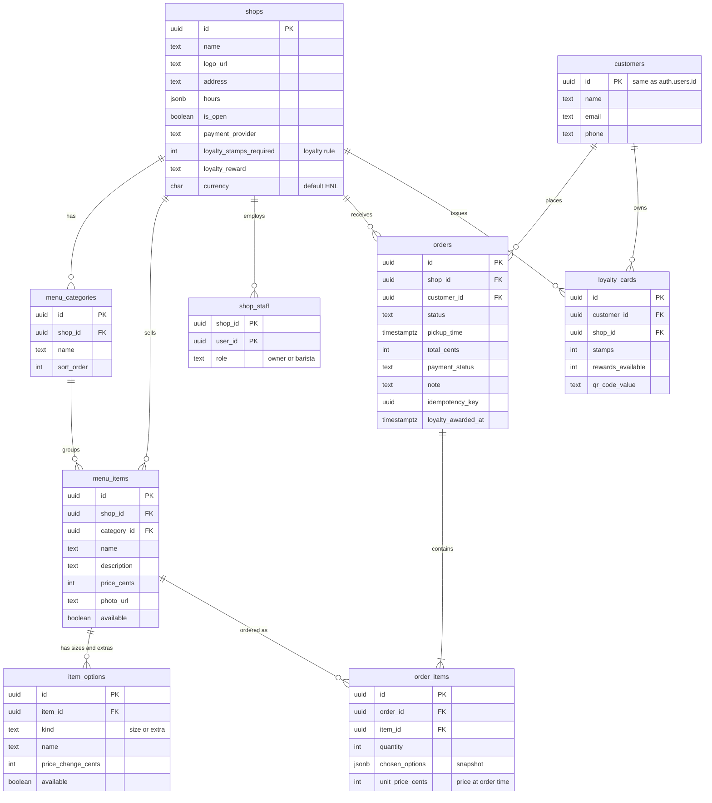
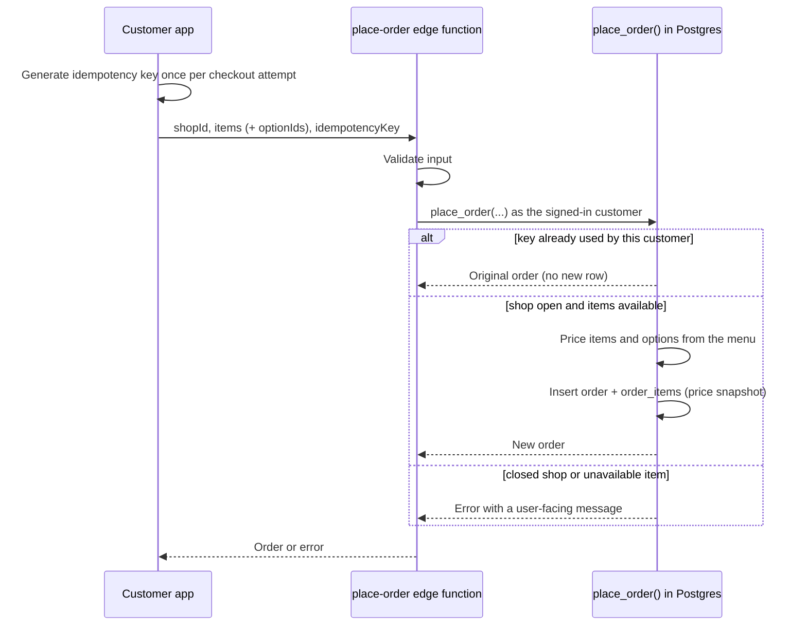
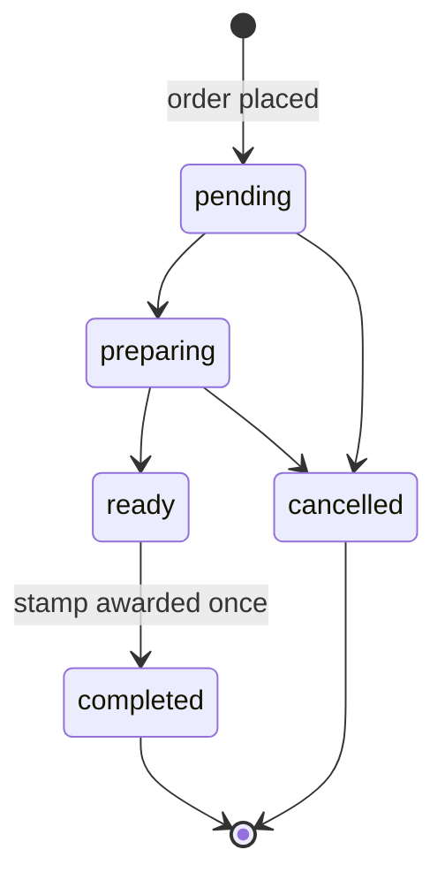

# MiBarra data model

The MVP data model lives in Supabase (Postgres). The source of truth is `supabase/migrations`
(`20261112000000_init.sql`, then `20261114000000_data_model.sql`); the matching TypeScript types are in
`packages/shared/src/types.ts`. A test (`packages/shared/src/data-model.test.ts`) fails if the two drift apart.

Conventions:

- **Money** is stored as integer cents (`price_cents`, `total_cents`, ...). The default currency is `HNL` (lempiras).
- **Ids** are UUIDs. `customers.id` is the same id as the login in `auth.users`.
- **Row level security (RLS)** is enabled on every table. Clients can never write orders or loyalty data directly.

## Entity relationship diagram

## Tables

| Table | Purpose | Key fields and rules |
| :--- | :--- | :--- |
| `shops` | One row per coffee shop | `name`, `logo_url`, `address`, `hours` (JSON per weekday), `is_open` (manual open/closed switch), `payment_provider` (`cash`, `stripe`, `paypal`, `other`), loyalty rule: `loyalty_stamps_required` + `loyalty_reward` (null = no program) |
| `menu_categories` | Groups of items | `shop_id`, `name`, `sort_order` |
| `menu_items` | Items for sale | `category_id`, `name`, `description`, `price_cents` (HNL), `photo_url`, `available`. `shop_id` is kept too and a composite foreign key guarantees the category belongs to the same shop |
| `item_options` | Sizes and extras | `item_id`, `kind` (`size`/`extra`), `name`, `price_change_cents` (may be negative), `available` |
| `customers` | App users | `name`, `email` and/or `phone` (at least one), `id` = login id. Created automatically when someone signs up |
| `orders` | One per order | `shop_id`, `customer_id`, `status` (`pending` → `preparing` → `ready` → `completed`, or `cancelled`), `pickup_time`, `total_cents`, `payment_status` (`pending`, `paid`, `failed`, `refunded`), `note` (max 280), `idempotency_key` |
| `order_items` | Lines in an order | `order_id`, `item_id`, `quantity` (1-99), `chosen_options` (snapshot of name and price change), `unit_price_cents` (price at time of order, options included) |
| `loyalty_cards` | One per customer per shop | `customer_id`, `shop_id`, `stamps`, `rewards_available`, `qr_code_value` (unguessable, unique). `unique (customer_id, shop_id)` |
| `shop_staff` | Which logins work at which shop | `shop_id`, `user_id`, `role` (`owner` can edit the shop and menu, `barista` can only work orders) |

## How an order is created (idempotent)

Orders are created only by the `place_order` database function, called from the `place-order` edge function.
Prices always come from the menu, never from the app.

`unique (customer_id, idempotency_key)` also protects against two retries racing each other.

## Loyalty stamps

A shop's rule is "a reward every N completed orders" (`loyalty_stamps_required`). When an order moves to
`completed`, a trigger gives the customer one stamp. `orders.loyalty_awarded_at` is set in the same step
and only the first transition can set it, so changing the status back and forth never awards twice.

For example with `loyalty_stamps_required = 8`, the 8th completed order resets `stamps` to 0 and adds 1 to
`rewards_available`. Cancelled orders never earn a stamp.

## Who can read and change what (RLS)

| Table | Public (not signed in) | Customer | Barista | Owner |
| :--- | :--- | :--- | :--- | :--- |
| `shops` | read | read | read | read, update |
| `menu_categories`, `menu_items`, `item_options` | read | read | read | read, create, update, delete |
| `customers` | none | read and update own row | read customers who ordered at their shop | same as barista |
| `orders` | none | read own | read shop's, update `status` only | same as barista |
| `order_items` | none | read own | read shop's | read shop's |
| `loyalty_cards` | none | read own | read shop's | read shop's |
| `shop_staff` | none | none | read own shop's team | read, add, remove |

Extra protections:

- No client can insert or delete orders, order lines or loyalty cards; there is no policy for it.
- Signed-in clients only have the database privilege to update `orders.status`. A trigger also rejects changes to
  totals, owner, pickup time, note and payment status. Server-side code without a signed-in user (for example a
  payment webhook using the service role) can update `payment_status`.
- Orders and their lines are never deleted when a menu item changes: items that were ordered cannot be deleted,
  they are marked `available = false` instead.

## Not covered yet

- Redeeming a reward (decrementing `rewards_available` when staff scan `qr_code_value`).
- Setting `pickup_time` and `note` through the edge function (the database function already supports them).
- Calling a payment provider and updating `payment_status`.
